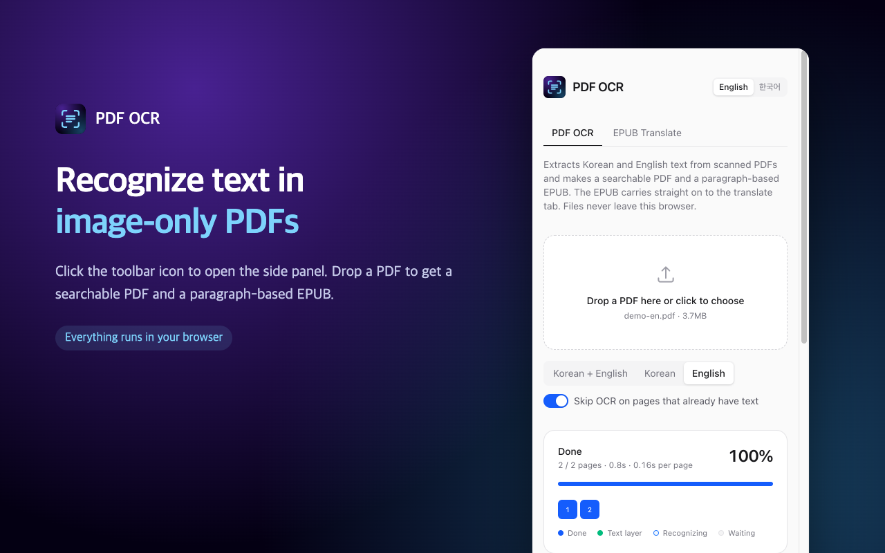
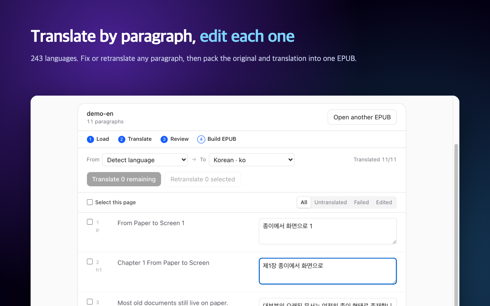
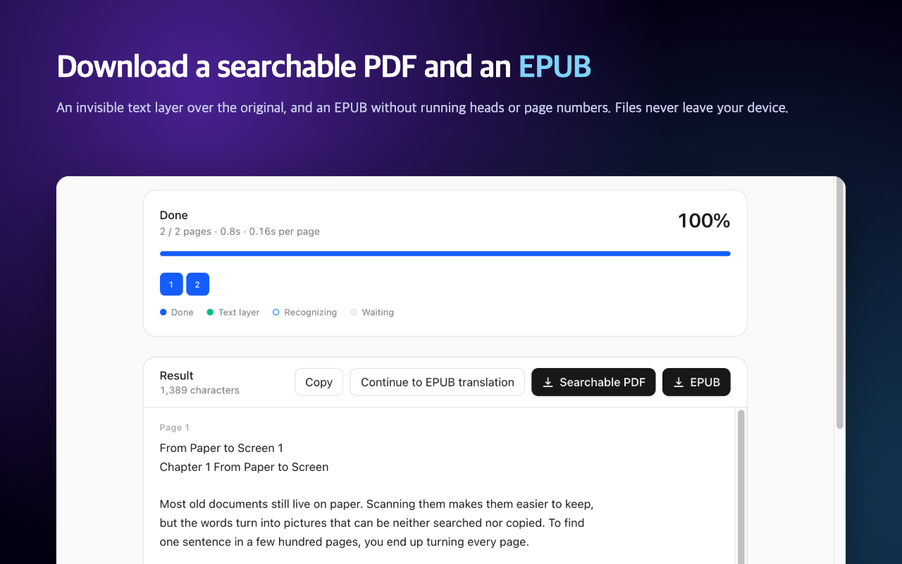
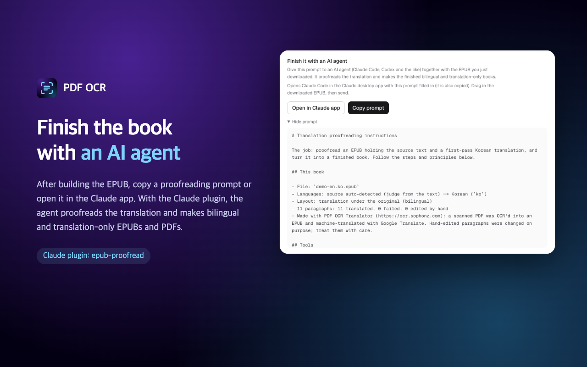

# PDF OCR Translator

[](https://github.com/sophonz-labs/pdf-ocr-translator/actions/workflows/pages.yml)
[](https://github.com/sophonz-labs/pdf-ocr-translator/actions/workflows/chrome-web-store.yml)
[](https://chromewebstore.google.com/detail/ekmifaliobndkahdekofgekknfbhojfn)
[](LICENSE)

Turn image-only PDFs (scans, photographed pages) into searchable PDFs and paragraph-based EPUBs, then translate them. Everything runs in the browser; files never leave the device.

- Web: https://ocr.sophonz.com
- Chrome extension: [Chrome Web Store](https://chromewebstore.google.com/detail/ekmifaliobndkahdekofgekknfbhojfn), the same tools in Chrome's side panel ([extension/README.md](extension/README.md))



| | |
|---|---|
|  |  |
|  | |

## How it works

- [pdf.js](https://github.com/mozilla/pdf.js) renders each page to a canvas (legacy build, for Safari and older Chrome), with its wasm decoders for JBIG2/JPEG2000 scans.
- [tesseract.js](https://github.com/naptha/tesseract.js) runs OCR in Web Workers, up to 4 pages in parallel, `kor+eng` by default. Worker, wasm core and models are self-hosted (no CDN). Pages that already have a text layer can skip OCR.
- **Searchable PDF**: the original PDF with an invisible text layer per OCR line ([pdf-lib](https://pdf-lib.js.org), NanumGothic subset for Hangul).
- **EPUB**: reading structure rebuilt from line positions (`src/lib/layout.ts`): paragraphs from indentation, spacing and short last lines; headings from font size; running heads, page numbers and footnotes separated; hyphenation and Korean mid-word breaks joined using the document's own vocabulary. Chapters and a nested table of contents come from the PDF's bookmarks when it has them, page 1 becomes the cover, and pictures on scanned pages are cut out and placed where they sit (`src/lib/figures.ts`). The same structure exports as Markdown (a zip with an `images/` folder when there are pictures). A page range (`20-80`, `1-5, 9`) limits what is read.
- **Resume**: finished pages and translations in progress are kept in the browser's IndexedDB (`src/lib/store.ts`), keyed by the file's name, size and modification time. Opening the same file again continues where it stopped; nothing is kept for more than 30 days.
- **EPUB translation** works on any EPUB or on the OCR result. It is step by step, like the advanced mode of [ebook-translator-calibre-plugin](https://github.com/bookfere/ebook-translator-calibre-plugin): translate untranslated or selected paragraphs, review and edit each, then build the EPUB with the translation alone or under the original. 243 languages. It calls Google Translate's keyless endpoint (the plugin's "Google (Free) - New" engine, `src/lib/translate.ts`) straight from the browser. This is the only feature that sends text off the device, and only the paragraph text. Italics, bold, superscripts and links go out as tags and come back in place (`src/lib/inline.ts`). In Chrome, the built-in Translator API is offered as a second engine that translates on the device (`src/lib/on-device.ts`).
- **Translated PDF** (OCR results only): the original pages with each paragraph covered and its translation set in the same area, shrunk to fit (`src/lib/translated-pdf.ts`). The font (NanumGothic) covers Hangul, Latin, Greek, Cyrillic, kana and common Hanja; other scripts need the EPUB.

## Layout

- `src/app/[lang]/`: the site in English (`/en/`, default) and Korean (`/ko/`); `/` forwards to the saved language. All text is in `src/i18n.ts`.
- `src/app/tools.tsx`, `translator.tsx`, `ocr.ts`: the tools, shared by the site and the extension.
- `extension/`: Chrome extension (Vite build of the same tools).

## Develop

```sh
bun install    # postinstall copies worker/wasm files into public/vendor
bun dev
bun run test   # layout/EPUB/translation unit tests (Node 22.6+)
bun run build  # static export to out/
bun run build:extension
```

Pushing to `main` builds the static site and publishes it to the `gh-pages` branch (GitHub Pages, `ocr.sophonz.com`).

The site build reads these repository variables; each is off when unset:

| Variable | Purpose |
|---|---|
| `CWS_URL` | Chrome Web Store link on the landing page |
| `GA_ID` | Google Analytics 4 measurement ID (`G-…`); also adds the visit-statistics section to the privacy policy |
| `GSC_VERIFICATION` | Google Search Console HTML-tag verification code |
| `NAVER_VERIFICATION` | Naver Search Advisor verification code |

Pushing a `v<version>` tag that matches `package.json` builds the extension, uploads it to the Chrome Web Store and submits it for review (secret `CWS_SERVICE_ACCOUNT`).

## Claude Code plugin: proofread the translation

After "Build EPUB", the app shows a prompt for an AI agent that finishes the book. In Claude Code, the `epub-proofread` plugin in this repository does the mechanical parts with scripts:

```
/plugin install epub-proofread --marketplace sophonz-labs/pdf-ocr-translator
```

Then `/epub-proofread:proofread`. It takes a bilingual EPUB from this app (or from calibre Ebook Translator) and makes a glossary, a proofread bilingual EPUB and PDF, and a translation-only EPUB and PDF, with Noto Serif and KoPub Batang embedded and justified PDF text.

Needs Python 3.9+, `pip install fonttools pymupdf`, and [calibre](https://calibre-ebook.com). For Korean, install KoPub Batang (Light, Medium, Bold) from the Korean Publishers Society (kopus.org); it isn't bundled. `scripts/doctor.py` checks all of this. The plugin lives in `plugins/epub-proofread/`; the marketplace file is `.claude-plugin/marketplace.json`.

## Adding an OCR language

Drop `<lang>.traineddata` from [tessdata_fast](https://github.com/tesseract-ocr/tessdata_fast) into `public/models/`, add it to `OCR_LANGS` in `src/app/tools.tsx` (combine with `+`, e.g. `jpn+eng`), and add labels under `ocr.langs` in `src/i18n.ts`.

## License

MIT. Bundled third-party files keep their own licenses: tessdata models (Apache-2.0), NanumGothic (SIL OFL 1.1, `public/fonts/OFL.txt`); Geist Bold and NanumGothic Bold in `src/og/`, used only to render Open Graph images at build time (SIL OFL 1.1); tesseract.js and pdf.js files copied at install time are Apache-2.0; Noto Serif in `plugins/epub-proofread/fonts/` (SIL OFL 1.1).
